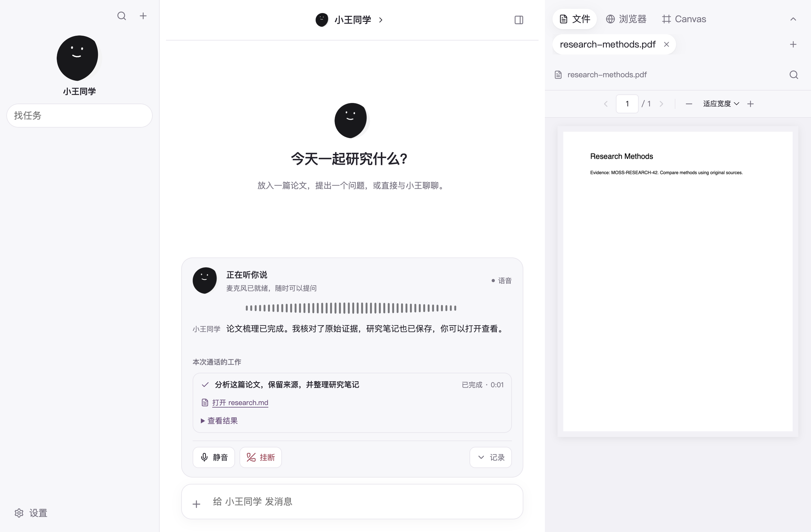

<p align="center">
  
</p>

<h1 align="center">XiaoWang · 小王同学</h1>
<p align="center">A desktop companion for conversations, papers, research, and everyday work.</p>
<p align="center"><a href="https://github.com/koabula/xiaowang/releases/latest">Download</a> · <a href="README.md">简体中文</a> · <a href="https://github.com/koabula/xiaowang/issues">Report an issue</a></p>

Speak naturally or give instructions in text. XiaoWang brings realtime voice and a background agent together: longer research runs while your conversation continues, and XiaoWang can tell you when the results are ready. PDFs, web pages, Canvas presentations, and generated notes share one window.



*Actual desktop UI from the current source, demonstrated with local mock services and sample material. This does not measure real-model answer quality or latency.*

## Download and update

Choose an installer from the [latest GitHub Release](https://github.com/koabula/xiaowang/releases/latest):

| System | Architecture | File |
| --- | --- | --- |
| macOS | Apple Silicon: `arm64`; Intel: `x64` | `.dmg` |
| Windows | `x64` | `.exe` |
| Linux | `x64` | `.AppImage` or `.deb` |

Settings shows the installed version, with a **Check for updates** button beside it. Installed builds also check on startup and every six hours. When a newer release is available, a circular download icon appears beside Settings. Click it to see download progress, followed by verification, installation and restart. Calls, background work, and unsaved settings defer installation; the UI explains what it is waiting for. Versions 0.1.4 and earlier need one manual installation of a version that includes the updater. Unsigned installers may trigger an operating-system security prompt. UI descriptions follow the current main branch; consult release notes for features in published installers.

**MOSS Live is temporarily unavailable in v0.1.8.** Its Settings option is removed, while its implementation and saved profiles remain. Existing MOSS selections switch to another configured voice provider; if none is configured, set up voice before calling.

## First run

1. Open **Settings → Text model** and enter the API address, model name, and key. The background agent uses this model to read sources, call tools, and complete work.
2. For calls, separately choose a **voice** service, model, and voice, and enter that provider's key. Voice is optional; text and voice can use different providers.
3. Create a topic workspace and add a paper or document, or start by typing a question. Click the **voice button on the right of the message input** to begin a call.

The available voice providers are OpenAI, Qwen, and Doubao full-duplex. Each voice provider keeps its own key, model and voice, restored when you switch back. A blank key retains that provider's saved key; use the explicit removal control to clear it. Voice credentials are separate from the text model's credentials, and delegated work still runs through your configured background model.

See the [development notes](DEVELOPMENT.md#moss-live) for the retained MOSS implementation, known protocol issues and development tests.

## Work with XiaoWang

**Read a paper**

> Explain this paper's research question, methods, and main findings. Include source page numbers and save a note.

**Look and talk together**

> Walk me through this material page by page. I’ll interrupt when I have questions.

**Compare and research**

> Compare these papers' experimental settings and limitations. Write a note about the differences and let me know when it is ready.

Click **＋** under **Files** or **Canvas** to browse the current workspace's imported originals, folders, and recently opened materials. PDFs support continuous scrolling, text selection, search, and zoom; source citations can jump to the original page. XiaoWang controls the browser by default. Take control before interacting with the web page yourself.

Each **workspace** keeps its own conversations, materials, and reading position. Voice-delegated **background tasks** live inside their source **call record**: expand the call to see progress, full results, generated files, or controls to stop and retry work. Ordinary text chat displays replies directly without an extra task card. Interrupting speech stops playback while background work continues; use the task's stop button to cancel the work.

Call and work records survive restarts. Work running when the app exits is marked interrupted. Check existing output before retrying manually to avoid duplicate actions.

## Your materials and models

Conversations and documents are stored locally in `~/.xiaowang/` by default. Voice, relevant context, and material needed for a task are sent to your configured model services. This is not a fully offline assistant. Settings live in the app's configuration directory; keys use operating-system secure storage when available, with local-file storage as a fallback.

The retained MOSS implementation uses isolated session memory. The app does not enable shared cloud long-term memory across workspaces by default. Consult each provider's policies for data retention and use.

OCR for scanned documents is not included yet. Check model findings and action outcomes against the original sources.

## Development and feedback

You need **Node.js 24+** and npm:

```sh
npm ci
npm run desktop
```

See the [development notes](DEVELOPMENT.md) for the project layout, configuration, tests, packaging, and release workflow. Main-branch test installers are available under **Actions → Desktop installers → a workflow run → Artifacts**.

When reporting an [issue](https://github.com/koabula/xiaowang/issues), include the operating system, app version, voice provider, and reproduction steps. Remove keys and private material.
