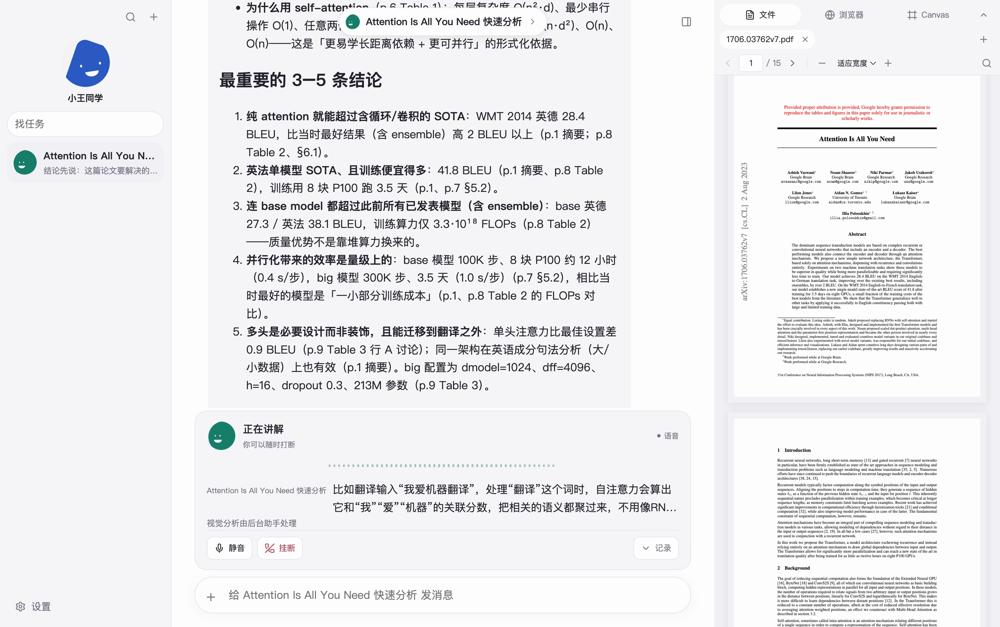

<p align="center">
  
</p>

<h1 align="center">XiaoWang · 小王同学</h1>
<p align="center">A desktop companion for conversations, papers, research, and everyday work.</p>
<p align="center"><a href="https://github.com/koabula/xiaowang/releases/latest">Download</a> · <a href="README.md">简体中文</a> · <a href="https://github.com/koabula/xiaowang/issues">Report an issue</a></p>

Speak naturally or give instructions in text. XiaoWang brings realtime voice and a background agent together: longer research runs while your conversation continues, and XiaoWang can tell you when the results are ready. PDFs, web pages, Canvas presentations, and generated notes share one window.

## Demo video

[](assets/readme/attention-demo.mp4)

[▶ View the HD demo (1:43, 2940 × 1846 · 30 fps)](assets/readme/attention-demo.mp4)

Starting with a fresh workspace, ask XiaoWang to fetch *Attention Is All You Need* and create a sub bot for a quick analysis, then call to discuss the paper, self-attention, and an example. The demo includes immediate follow-ups to short answers, a voice interruption, and a spoken request to hang up. It uses real model services: Doubao's Xiaohe 2.0 for XiaoWang and Bill TTS for the questions, with actual waiting and conversation preserved. The conversation is in Chinese.

<details>
<summary>More interface examples</summary>


*This screenshot uses local mock services and sample material; it does not measure real-model answer quality or latency.*

</details>

## Download and update

Choose an installer from the [latest GitHub Release](https://github.com/koabula/xiaowang/releases/latest):

| System | Architecture | File |
| --- | --- | --- |
| macOS | Apple Silicon: `arm64`; Intel: `x64` | `.dmg` |
| Windows | `x64` | `.exe` |
| Linux | `x64` | `.AppImage` or `.deb` |

Settings shows the installed version, with a **Check for updates** button beside it. Installed builds also check on startup and every six hours. When a newer release is available, a circular download icon appears beside Settings. Click it to see download progress, followed by verification, installation and restart. Calls, background work, and unsaved settings defer installation; the UI explains what it is waiting for. Versions 0.1.4 and earlier need one manual installation of a version that includes the updater. Unsigned installers may trigger an operating-system security prompt. UI descriptions follow the current main branch; consult release notes for features in published installers.

**MOSS Live is temporarily unavailable in v0.1.8.** Its Settings option is removed, while its implementation and saved profiles remain. Existing MOSS selections switch to another configured voice provider; if none is configured, set up voice before calling.

## First run

1. Open **Settings → Text model** and enter the API address, model name, and key. The background agent uses this model to read sources, call tools, and complete work.
2. For calls, separately choose a **voice** service, model, and voice, and enter that provider's key. Voice is optional; text and voice can use different providers.
3. Create a topic workspace and add a paper or document, or start by typing a question. Click the **voice button on the right of the message input** to begin a call.

The available voice providers are OpenAI, Qwen, Doubao full-duplex, and **Gemini Live**. Each voice provider keeps its own key, model and voice, restored when you switch back. A blank key retains that provider's saved key; use the explicit removal control to clear it. Voice credentials are separate from the text model's credentials, and delegated work still runs through your configured background model.

For Gemini, select **Gemini Live** under **Settings → Voice** and enter your own [Google Gemini API Key](https://aistudio.google.com/api-keys). The integration uses Gemini 3.8 Live with 30 prebuilt voices and preview playback. Calls can resume the same remote session after a disconnection. The app advances a complete walkthrough after actual playback, with pause and resume controls. Repeat anything said while the connection was unavailable.

See the [development notes](DEVELOPMENT.md#moss-live) for the retained MOSS implementation, known protocol issues and development tests.

## Work with XiaoWang

Paste a screenshot, drag files into the message input, or click **＋** to attach files. Preview and remove attachments before sending, or send them without text. Supported formats: PNG, JPEG, WebP, GIF, PDF, TXT, Markdown, CSV and JSON. Each message accepts up to 8 files, 20 MB per file and 40 MB total. Attachments stay in the current bot’s library and remain linked to their message. Images require a **text model with vision support**; configuring a voice model alone does not give the background model vision.

During calls, **Gemini Live, OpenAI and Qwen** also receive images from sent messages in the current bot and the image or current PDF page open in the right panel. PDFs are rendered page by page; the app does not continuously upload the whole document or desktop. Page/context updates remain silent, and the call panel shows the source and sharing status. Unsent drafts stay private; switching bots or hiding the panel clears the visible-page context. Background jobs use a snapshot accepted at delegation, so inspecting another source does not change ongoing work. Doubao visual input has not been verified on the current direct WebSocket interface; use a vision-capable background model for image and PDF analysis.

**Read a paper**

> Explain this paper's research question, methods, and main findings. Include source page numbers and save a note.

**Look and talk together**

> Walk me through this material page by page. I’ll interrupt when I have questions.

**Compare and research**

> Compare these papers' experimental settings and limitations. Write a note about the differences and let me know when it is ready.

**Ask XiaoWang to create a sub bot**

> Create a sub bot named “Full-duplex speech research.” Summarize our agreed goals, keywords, and paper leads in its task brief, and have it start a literature review.

XiaoWang creates a new workspace in the sidebar and can start its first task immediately. Sub bots have separate conversations and files, receiving the relevant background through their task brief. They do not automatically copy the parent's entire chat or files. Right-click a sidebar bot to rename or delete it; the main assistant cannot be deleted. Deletion stops that bot's calls and tasks, while local history and files remain on disk.

When delegating an existing paper, ask XiaoWang to pass it to the sub bot. Only the selected file references are shared; the child’s first turn starts after the parent finishes handing over the material.

Click **＋** under **Files** or **Canvas** to browse the current workspace's imported originals, folders, and recently opened materials. PDFs support continuous scrolling, text selection, search, zoom, trackpad pinch and Ctrl + wheel zoom; source citations can jump to the original page. Each bot has its own browser page, navigation history and control rights, while sharing website sign-ins. Logging out or changing a website account affects the other bots using that shared profile. Take control before interacting with the current bot’s web page yourself.

Each **workspace** keeps its own conversations, materials, and reading position. Voice-delegated **background tasks** live inside their source **call record**: expand the call to see progress, full results, generated files, or controls to stop and retry work. Ordinary text chat displays replies directly without an extra task card. Interrupting speech stops playback while background work continues; use the task's stop button to cancel the work.

Call and work records survive restarts. Work running when the app exits is marked interrupted. Check existing output before retrying manually to avoid duplicate actions.

## Your materials and models

Conversations and documents are stored locally in `~/.xiaowang/` by default. Voice, relevant context, and material needed for a task are sent to your configured model services. This is not a fully offline assistant. Settings live in the app's configuration directory; keys use operating-system secure storage when available, with local-file storage as a fallback.

The retained MOSS implementation uses isolated session memory. The app does not enable shared cloud long-term memory across workspaces by default. Consult each provider's policies for data retention and use.

OCR for scanned documents is not included yet. Check model findings and action outcomes against the original sources.

## Development and feedback

You need **Node.js 24+** and npm:

```sh
npm ci
npm run desktop
```

See the [development notes](DEVELOPMENT.md) for the project layout, configuration, tests, packaging, and release workflow. Main-branch test installers are available under **Actions → Desktop installers → a workflow run → Artifacts**.

When reporting an [issue](https://github.com/koabula/xiaowang/issues), include the operating system, app version, voice provider, and reproduction steps. Remove keys and private material.
