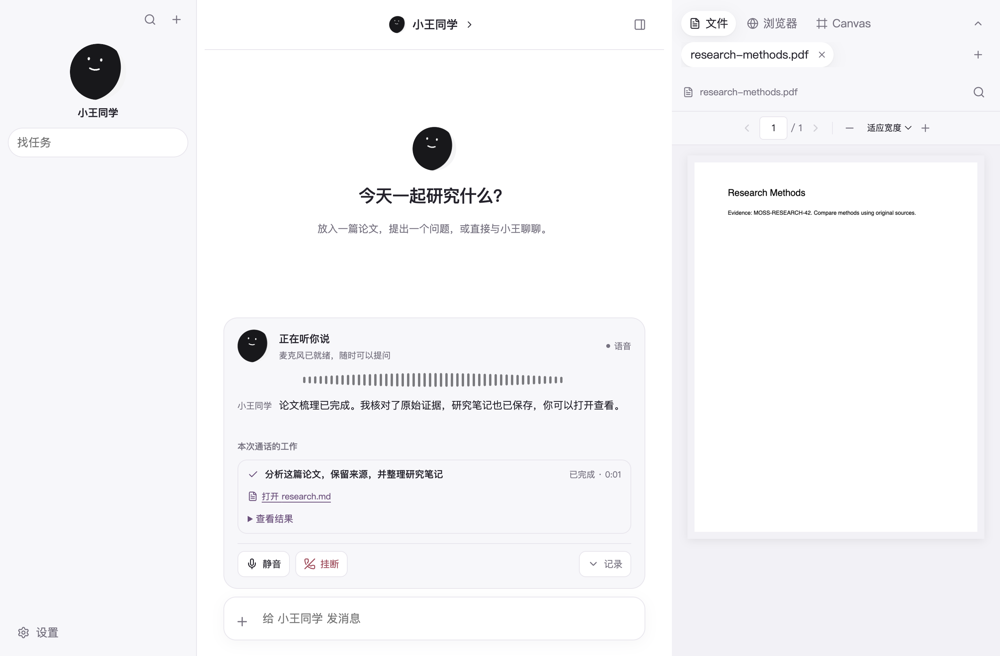

<p align="center">
  
</p>

<h1 align="center">小王同学</h1>
<p align="center">能聊天，也能一起读论文、查资料、做研究的桌面助手。</p>
<p align="center"><a href="https://github.com/koabula/xiaowang/releases/latest">下载最新版</a> · <a href="README.en.md">English</a> · <a href="https://github.com/koabula/xiaowang/issues">反馈问题</a></p>

直接开口交流，也可以用文字布置工作。小王把实时语音和后台 Agent 放在一起：复杂的调研交给后台处理，通话可以继续；完成后，再把结果告诉你。PDF、网页、讲解用的 Canvas 和生成的笔记都在同一个窗口中。



*当前源码的真实桌面界面；演示使用本地模拟服务与示例资料，不代表真实模型的回答质量或延迟。*

## 下载与更新

在 [GitHub Releases 最新版](https://github.com/koabula/xiaowang/releases/latest) 中选择适合设备的安装包：

| 系统 | 架构 | 文件 |
| --- | --- | --- |
| macOS | Apple Silicon：`arm64`；Intel：`x64` | `.dmg` |
| Windows | `x64` | `.exe` |
| Linux | `x64` | `.AppImage` 或 `.deb` |

设置页显示当前版本，版本号旁可手动**检查更新**；安装后的应用也会在启动时及每 6 小时自动检查。发现新版时，设置按钮右侧会出现圆形下载图标；点击后显示下载进度，再进行校验、安装和重启。通话、后台工作和未保存的设置会让安装等待，界面会说明等待原因。0.1.4 及更早版本需要先手动安装一次带有更新功能的版本。未签名的安装包可能出现系统安全提示。界面说明以当前主分支为准，已发布安装包以对应 Release 说明为准。

**v0.1.8 暂停提供 MOSS Live。** 设置中已移除该选项，相关代码与已保存配置保留。原来选择 MOSS 的用户会切换到已配置的其他语音服务；没有其他配置时，需要先配置语音服务。

## 第一次使用

1. 安装并打开应用，在**设置 → 文字模型**中填写接口地址、模型名与密钥。后台 Agent 用它阅读资料、调用工具和完成工作。
2. 需要通话时，在**语音**部分另选服务、模型和音色，填写该服务的密钥。语音可选，文字与语音可以使用不同服务商。
3. 建立一个主题工作区，添加论文或资料；也可以先直接输入问题。点击**输入框右侧的语音按钮**开始通话。

当前可选语音服务为 OpenAI、通义千问、豆包全双工和 **Gemini Live**。各语音服务分别保存密钥、模型和音色，切换时恢复各自配置；留空保留当前服务的密钥，清除则使用明确的清除按钮。语音密钥与后台文字模型密钥独立，复杂任务仍由你配置的后台模型执行。

使用 Gemini 时，在**设置 → 语音**选择 **Gemini Live**，填写自己的 [Google Gemini API Key](https://aistudio.google.com/api-keys)。当前接入 Gemini 3.8 Live，提供 30 种预置音色及试听。通话支持同一会话的断线恢复；完整讲解由应用在实际播放结束后自动翻页，支持暂停和恢复。恢复连接后，请重述断线期间的话。

MOSS 的保留实现、已知协议问题与开发测试方式见[开发说明](DEVELOPMENT.md#moss-live)。

## 和小王一起做什么

输入栏支持粘贴截图、拖入文件或点击 **＋** 添加附件；发送前可查看缩略图、移除附件，也可以只发送附件。支持 PNG、JPEG、WebP、GIF、PDF、TXT、Markdown、CSV 和 JSON，每条消息最多 8 个文件，单个不超过 20 MB、合计不超过 40 MB。附件保存在当前 bot 的资料库，并关联到这条消息。图片需要配置支持视觉输入的**文字模型**；仅配置语音模型不会让后台模型具备看图能力。

通话中的 **Gemini Live、OpenAI 和千问**还会收到当前 bot 已发送消息里的图片，以及右侧打开的图片或 PDF 当前页。PDF 按页渲染为图像同步，不会把整份 PDF 或整个桌面持续上传；翻页只更新上下文，不会自动插话。通话面板会显示共享状态和来源。未发送的附件草稿不会共享，切换 bot 或收起资料区后会撤销当前可见页面。后台任务使用接单时的上下文快照，临时翻看其他资料不会改变正在执行的任务。豆包当前直连接口的视觉输入尚未验证通过，图片与 PDF 分析先由支持视觉的后台模型处理。

**读一篇论文**

> 帮我梳理这篇论文的问题、方法和主要结论，保留来源页码，并整理一份笔记。

**边看边聊**

> 带我把这份材料逐页讲完，我不明白的地方会打断你。

**比较与调研**

> 比较这几篇论文的实验设置和局限，把差异整理成笔记。完成后告诉我。

**让小王建立子 bot**

> 帮我建立一个名为“全双工语音研究”的子 bot，把我们已确认的研究目标、关键词和论文线索整理成任务说明，并让它先做一轮文献调研。

小王会在左侧建立新的主题工作区，并可以让它立即开始工作。子 bot 有独立的会话和资料目录，通过任务说明接收必要背景；不会自动复制父 bot 的完整聊天或全部文件。需要分析已有资料时，可以说“把这篇论文交给子 bot 分析”；所需原件通过引用交接，子 bot 的首轮工作会等父轮完成资料交接后再启动。右键侧栏的 bot 可以重命名或删除；主助手不能删除。删除会停止该 bot 的通话和任务，本机历史与文件保留。

右侧的**文件**和 **Canvas** 标签中，点击 **＋** 浏览当前工作区的导入原件、文件夹和最近打开的内容。PDF 支持连续滚动、文字选择、搜索与缩放，也支持触控板双指捏合及 Ctrl + 滚轮缩放，点击来源引用可以定位原文。每个 bot 拥有独立的浏览页面、导航历史和控制权，默认共享网站登录资料；切换 bot 不会改变其他 bot 正在浏览的页面。共享登录资料也意味着退出登录或切换网站账号会影响其他 bot。浏览器默认由小王操作；点击取得控制权后，用户才能操作当前 bot 的网页。

每个**工作区**保留自己的会话、资料和阅读位置。语音委派的**后台任务**保存在对应的**通话记录**内：展开通话查看进度、完整结果、生成文件，或停止、重试工作。普通文字聊天直接显示回复，不额外生成任务卡。插话会打断播报，后台工作仍继续；需要停止工作时，使用任务的停止按钮。

通话和工作记录在重启后保留。退出时正在执行的工作会标记为中断，检查已有输出后可手动重试，避免重复操作。

## 资料与模型

对话与资料默认保存在本机 `~/.xiaowang/`。应用会把语音、相关上下文与需要处理的资料发送给你配置的模型服务；这不是完全离线的助手。模型设置位于应用配置目录，密钥优先使用系统安全存储，系统不支持时使用本地文件存储。

保留的 MOSS 实现使用独立会话记忆；应用不会默认开启跨工作区共享的云端长期记忆。第三方服务的数据保留与使用规则请参阅各自政策。

扫描件 OCR 尚未接入。模型结论与操作结果应结合原始来源核对。

## 开发与反馈

需要 **Node.js 24+** 和 npm：

```sh
npm ci
npm run desktop
```

目录结构、配置、测试、打包及发布流程见[开发说明](DEVELOPMENT.md)。主分支的测试安装包位于 **Actions → Desktop installers → 对应运行 → Artifacts**。

遇到问题可在 [Issues](https://github.com/koabula/xiaowang/issues) 附上系统、应用版本、语音服务和复现步骤；请移除密钥与私密资料。
