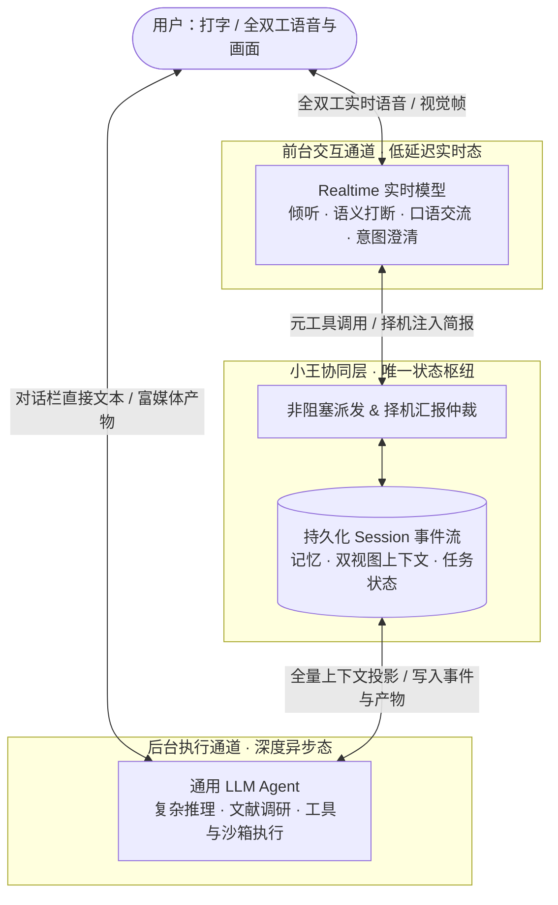

# 03. 前后台双模型协同机制

参考 MOSS-Live 的前后台协同思想，并将其泛化为一套**不绑定单一厂商模型的通用协同层（Coordinator）**，使任意主流 Realtime 模型与任意主流后台 LLM 都能组合成“能说会道、又能踏实干重活”的完整 Agent。

---

## 一、 前后台的角色分工边界

| 维度 | 前台 Realtime 模型（感官与嘴替） | 后台 LLM 模型（大脑与双手） |
| :--- | :--- | :--- |
| **核心职责** | 持续感知语音/画面、处理停顿与打断、日常快答、把模糊需求问清楚、自然播报结论 | 深度逻辑推理、长周期文献检索核验、读写文件与外部应用（MCP）、生成结构化报告 |
| **响应尺度** | 毫秒至百毫秒级实时反馈，绝不挂起冷场 | 秒级至数分钟级多步工具循环，允许深度慢思考 |
| **话术与人设** | 口语化、短句为主，**不向用户暴露“我转交给后台”之类的系统机制词汇**，像同一个人在边想边聊 | 严谨、结构化；当为语音通话服务时，额外附带一份适合耳朵听的精炼口语摘要 |

---

## 二、 协同层的四个核心机制

### 1. 双视图非对称上下文投影（Dual-View Context）
前后台共享同一份底层记忆与事件流，但看到的“视图厚度”截然不同：
- **后台全量视图**：保留完整的对话脉络、检索到的长篇文献内容、代码细节与工具调用轨迹，充分发挥文本大模型的长上下文推理优势。
- **前台轻量视图**：Realtime 模型的音频/多模态上下文成本高且对冗余文本敏感。投影给前台的始终是**高浓缩摘要 + 实体指代**（例如告诉前台“刚刚已在 Zotero 归档了 7 篇论文并生成了对比笔记，核心有三条选题边界结论……”，而不是把几万字论文全文灌进语音会话）。
- **科研术语对齐**：针对中英夹杂的科研专有名词（算法缩写、数据集名、学者姓氏），前台负责通过课题热词提升听辨率；派发任务时可同时附带原始语音转写（及可选屏幕画面），由后台 LLM 结合科研语境自动纠正同音误识别。

### 2. 「立即回执」破除同步工具阻塞（Ack-and-Callback）
不同 Realtime 模型对工具调用的处理方式不同：有的原生支持后台异步执行，有的（如类 OpenAI / Qwen Realtime 默认流程）在发出工具调用后会暂停说话、同步等待工具结果返回。
- 为了统一兼容所有模型并保证**“执行任务期间，对话绝不中断”**，当前台模型决定把复杂问题交给后台时，协同层可以在**极短时间内先行返回一个“已受理（Accepted）”回执**，立刻释放前台的语音轮次，让前台顺畅接话或陪用户聊别的话题。
- 真正的重度任务在后台异步启动，与前台语音流彻底解耦。

### 3. 按需分级反馈（支持“无需反馈”的静默任务）
并非所有交给后台的指令都需要回头打断对话汇报一遍。任务派发天然支持不同的反馈预期：
- **静默执行（Silent / Fire-and-Forget）**：例如*“帮我把刚才提到的灵感记进备忘录”*、*“把这篇论文加到待读清单”*、*“设个明早的提醒”*。前台顺口回应一句“好，记下了”即告完结；后台静默完成落盘与界面状态更新，**成功后不再触发任何额外语音播报**（仅在执行异常失败时才主动告知用户）。
- **口头简报 + 界面详单（Brief + Artifact）**：例如文献调研、实验对比。完成后，完整报告与附件直接呈现在聊天窗口中；同时提取百字以内的核心口语结论送入择机仲裁器。
- **中途澄清与动态修正（Clarify / Cancel）**：如果后台在执行中发现缺少关键条件，可将状态置为待澄清，由前台找机会顺口追问用户一句；如果用户在聊天中途改了主意（*“只看 2025 年之后的论文”*或*“算了不用查了”*），前台可通过更新/取消指令随时终止或修正后台在途任务。

### 4. 择机汇报仲裁（Turn-Aware Delivery）
当后台结果就绪且需要口头告知用户时，绝不能生硬地截断正在进行的交流：
- 若底层 Realtime 模型原生支持异步旁白/评论通道（如 MOSS-Live 的 Commentary 机制），可直接交由模型内部状态机择机融入对话。
- 若底层为通用事件流模型，则由协同层观察双端状态——确保**用户没有正在说话、前台模型也没有正在播报，且留出自然的停顿气口**后，再触发口头汇报；若双方正聊在兴头上，则先在工作台亮起轻量提示，待话题告一段落再自然切入。

---

## 三、 实现阶段的开放探索空间

- **前台元工具的具体粒度**：是用极简的 2～3 个通用工具（如 `dispatch_task` / `check_tasks` / `manage_task`），还是把高频超快查询（如查当前时间/本地简单状态）做成毫秒级直返工具，可根据实测的首字延迟与提示词稳定性灵活调整。
- **上下文增量同步时机**：用户在通话的同时如果又在键盘上敲了一句补充说明或拖入了一个文件，如何最自然地通知正在通话的 Realtime 模型，可在实现时对比“静默更新会话指令”与“插入系统事件项”的实际表现。
