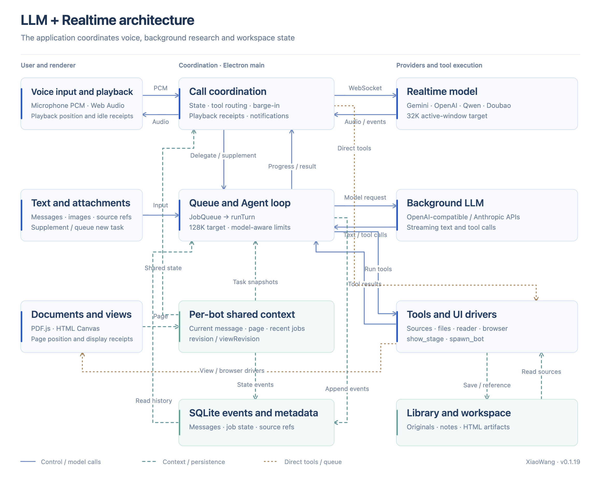
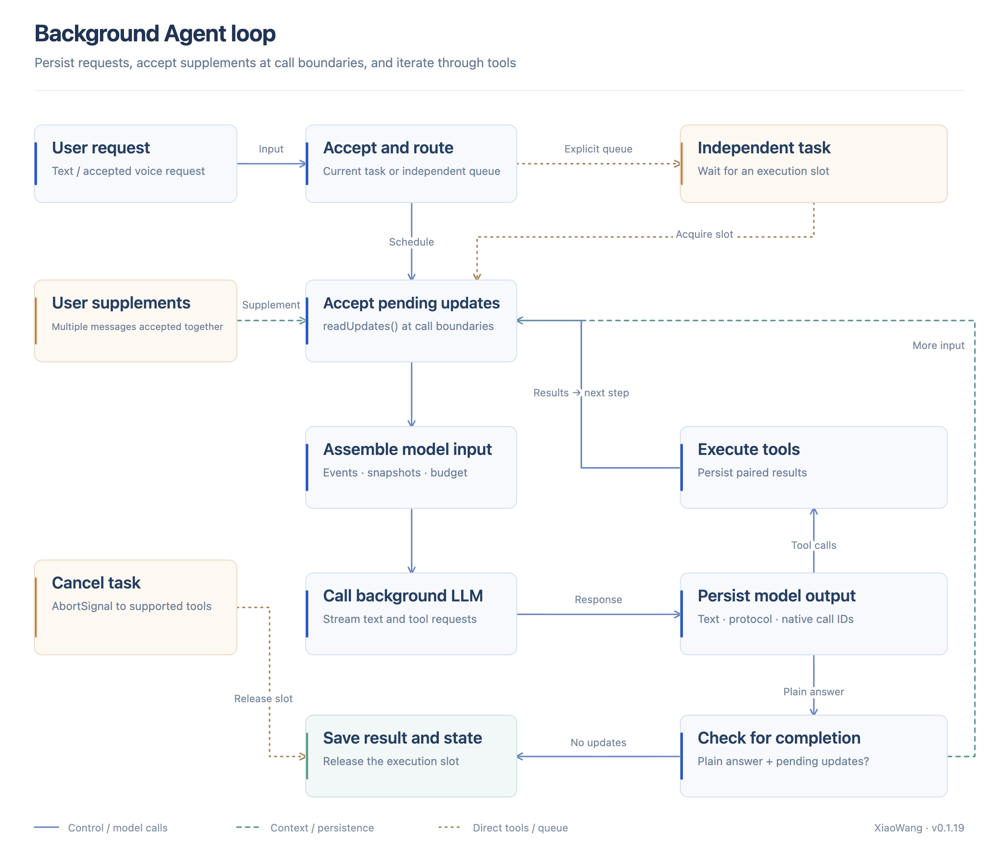
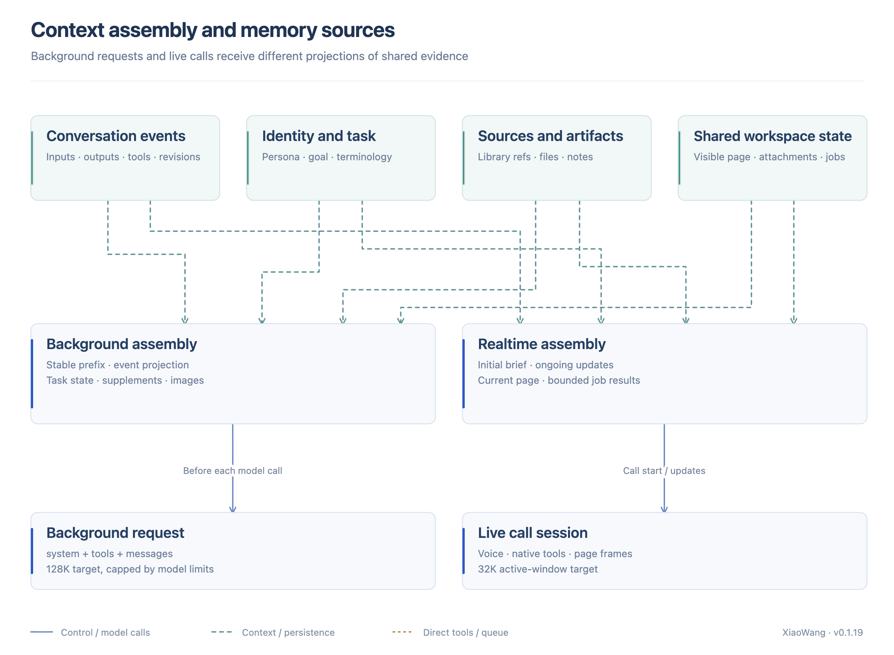
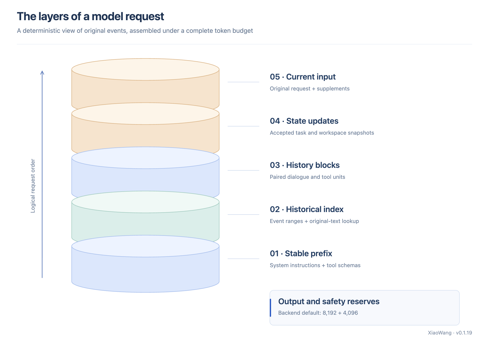
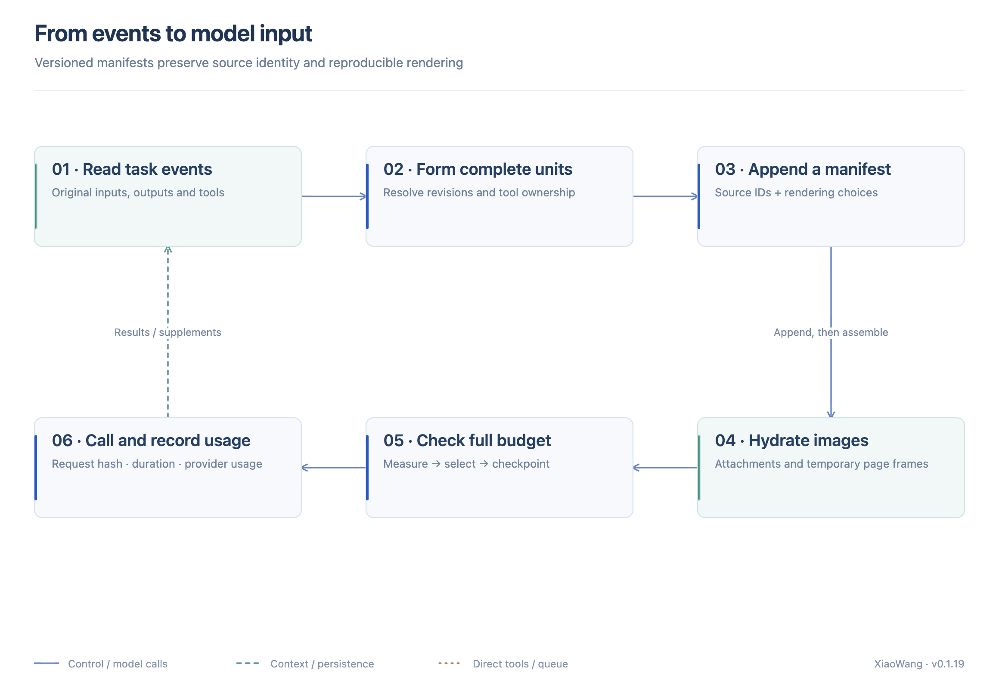
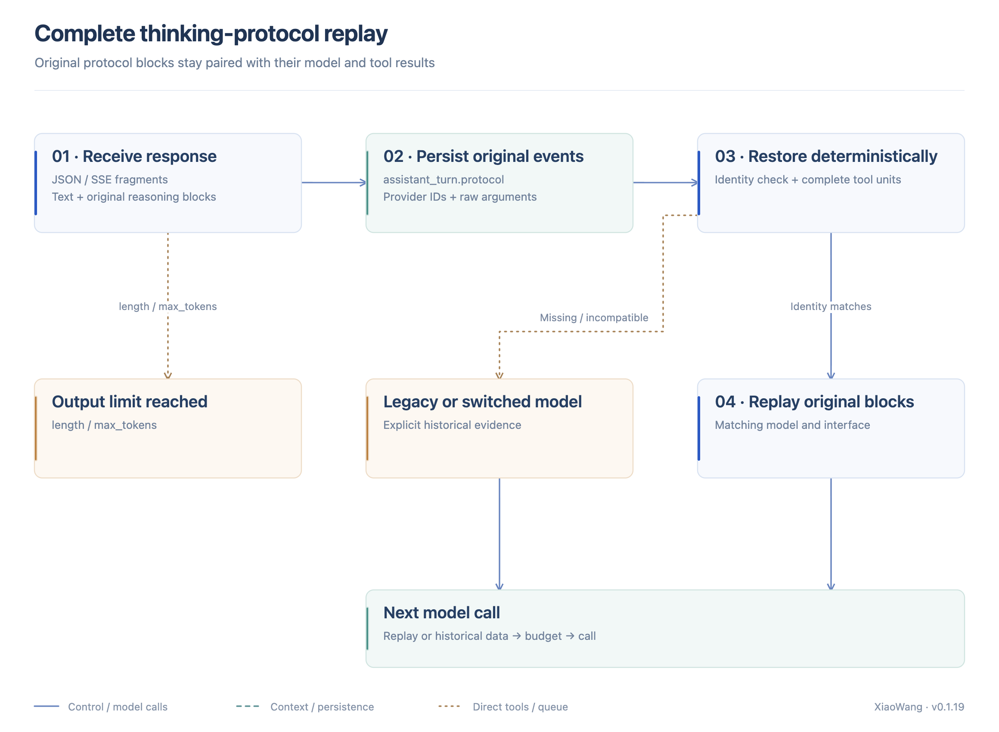
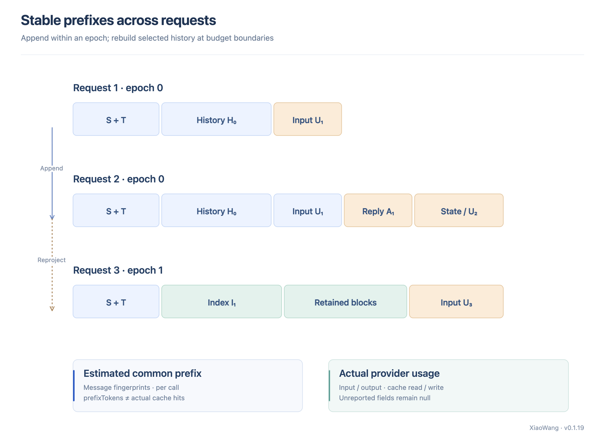
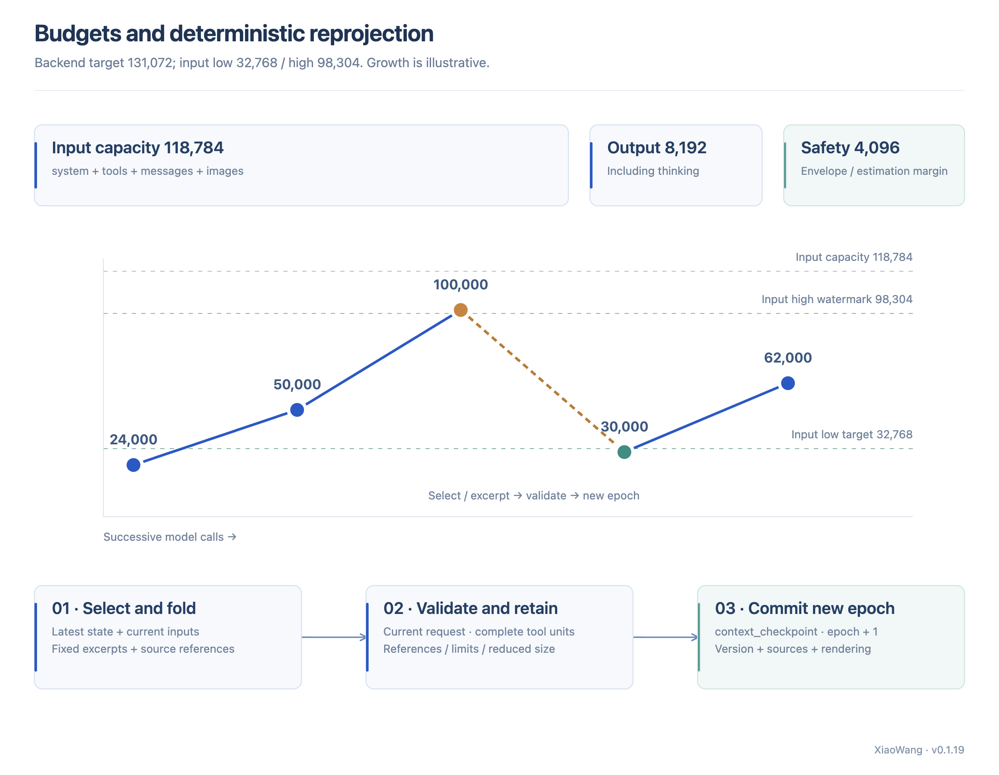

# XiaoWang Agent Architecture

[Interactive diagrams](index.en.html) · [简体中文](README.md) · Implementation as of v0.1.19.

## Conversation and research run at different speeds

Voice responses need to begin quickly. Research may require repeated searches, reading, and tool calls. Users also add requirements, interrupt explanations, or switch documents while work is in progress. XiaoWang assigns realtime conversation and research execution to separate models, coordinated by the application.

Models interpret requests, generate content, and select tools. The application records events, executes tools, and schedules the next action using task state and the audio the user has actually heard.

## How the models work together

Realtime handles voice and can read or display sources directly. Multi-step research enters the local `JobQueue` through `delegate_task` while the call continues accepting input. Progress and results enter the call context. Spoken notifications depend on user activity, playback state, and notification preferences.

The bot ID selects the conversation, library, and workspace. `originCallId` associates delegated work with its source call. Accepted research can continue after hangup, with its result retained inside that call's record.

[Desktop coordination](../desktop/main/index.ts) · [Voice delegation](../src/voice-tasks.ts)

## The Agent loop

The request is persisted before a task is created or supplemented. Each bot executes tasks serially, with at most two workspaces running concurrently by default. An explicit “Queue new task” action creates independent work.

Each step accepts pending supplements, prepares context, and calls the LLM. Tool calls lead to tool execution, persisted results, and the next model call. After a plain answer, the loop checks for supplements again and finishes when none remain.

New tool calls receive application-generated IDs. Original provider IDs and arguments are stored separately, and results link to execution events through `assistantEventId`. Duplicate IDs in legacy logs pair with the nearest matching call. Cancellation passes an `AbortSignal` to the model and cancellable tools. Desktop tasks have a 40-step limit, retaining output and supplements for inspection and retry.

[Execution loop](../src/harness.ts) · [Task queue](../src/jobs.ts)

## What each model receives

The background LLM receives a task view projected from events, including fixed rules, tools, selected history, task snapshots, current requirements, and images. Realtime receives a brief when the call starts and ongoing page, task, and result updates.

A task copies the workspace snapshot when accepted. Supplements bring their associated newer snapshots. Turning a page updates the call's visible-page context. An independent `viewRevision` rejects stale frames.

Gemini, OpenAI, and Qwen receive sent images and the image or PDF page open in the right panel. The visual queue sends at most one frame per second. Doubao currently delegates image and PDF analysis to the background model.

The initial call brief includes the latest six dialogue segments, each capped at 180 characters, a goal capped at 500 characters, terminology, a library catalog of up to 40 entries, and the latest eight artifact paths. Shared snapshots retain the latest six jobs, with each result capped at 3,000 characters. These bounds apply to briefs and shared state. Background history is selected using token budgets and task ownership.

Gemini Live also uses provider-side `slidingWindow` session compression. Its internal tokens and cache usage are separate from background-model statistics.

[Shared state](../src/shared-context.ts) · [Attachments](../src/attachments.ts) · [Visual queue](../src/visual-queue.ts)

## The layers of a background request

Stable `system` and `tools` fields describe identity, workspace rules, and capabilities. `messages` are rendered from explicit events and snapshots in the order and form specified by the projection manifest.

| Content | Source and policy |
| --- | --- |
| Fixed rules, tools, budget | `context_scope` stores the scope definition; identical configuration reuses the scope |
| Historical index and references | Archived history exposes event counts, ranges, and lookup tools |
| Selected dialogue and tool units | Original events; calls and results stay paired; same-model thinking and signatures replay intact |
| Task and workspace state | `context_state` stores accepted or supplemental snapshots; reprojection retains the latest value for each state key |
| Current request and supplements | Protected by the current task's input event IDs; wording is preserved |
| Images | Attachments load by reference; temporary page frames remain in process memory |

## Deterministic event projection

`projectContextUnits` forms complete units from events, resolving transcript revisions and tool-result ownership. `context_append` records source IDs, revision references, and rendering choices instead of maintaining another continuously rewritten message history.

`renderEntry` reconstructs a view using the manifest's specified events. Revisions to already-sent transcripts appear as appended corrections. The same events, version, budget, and available originals produce the same view. Projection makes no model calls and reexecutes no tools.

Normal execution uses this manager. The legacy character-trimming helper `projectLlmContext` remains for compatible callers. Temporary page frames are excluded from the event log, and state text describes their availability. After restart, attachment images can reload; temporary frames must be captured again.

[Event units](../src/project.ts) · [Pure projection functions](../src/event-projection.ts) · [Projection and checkpoints](../src/context-manager.ts)

## Thinking is protocol data

User-facing text and protocol replay data are stored separately. OpenAI-compatible adapters receive `reasoning_content` and `reasoning_details`. Anthropic adapters preserve complete content blocks, including thinking, signatures, and redacted thinking. SSE fragments assemble in order. Thinking content stays outside chat text and history search.

`assistant_turn.protocol` records the interface and model identity. Projection restores original protocol blocks. Tool results link through local call IDs and are sent using original provider IDs and arguments. Same-model replay data counts toward input budgets; output reserves include thinking. Reported `reasoningTokens` are a subset of output and are counted once.

Required protocol fields missing from old conversations cannot be reconstructed. Assistant/tool groups missing DeepSeek reasoning, groups from a different model or interface, and output-limited records become explicitly labeled historical data that preserves recorded results. Original events remain intact, and recovery reexecutes no tools. A `length` or `max_tokens` stop preserves protocol and usage, reports an incomplete response, and prevents execution of that step's tool calls.

Projection version 2 rebuilds manifests from original events while retaining version 1 manifests. Protocol blocks stay whole. Older units can become references; retained units replay in full.

[Provider adapters](../src/provider.ts) · [Protocol-compatible history](../src/protocol-history.ts) · [Protocol tests](../test/thinking-protocol.test.ts) · [DeepSeek protocol](https://api-docs.deepseek.com/guides/thinking_mode/)

## Stable prefixes and caching

Within an epoch, existing message blocks preserve content and order while new messages append. Updated task context, catalogs, and transcript corrections enter as new evidence. Fixed instructions and tool definitions remain stable, and adapters preserve user-message block boundaries.

Crossing the budget watermark triggers a deterministic rebuild and increments `epoch`. Older material can become fixed excerpts or historical references, followed by further append-only growth.

Official OpenAI requests use a scope- and epoch-derived `prompt_cache_key`. Anthropic uses automatic `cache_control`. Set `XIAOWANG_PROMPT_CACHE=off` to disable optional caching fields. Prefix stability allows reuse; the provider determines actual cache hits.

`model_usage` stores the request hash, complete budget, duration, and actual usage. OpenAI reports `cached_tokens`; DeepSeek provides cache-hit fields. Anthropic total input includes ordinary input, cache creation, and cache reads. Unreported metrics remain `null`. `prefixTokens` only estimates the common prefix of adjacent successful requests and resets after restart or epoch changes.

`npm run xiaowang -- stats [slug]` reports calls, checkpoints, and token usage. Cache-read ratios include only calls reporting both input and cache reads. Thinking usage is included when the provider reports it.

## Full budgets and deterministic reprojection

Text chat, sub bots, and voice-delegated tasks share a background target window of 131,072 tokens. Before a task starts, the application reads `/models` metadata for context, input, and output limits. Results are cached for five minutes, isolated by endpoint, model, and credentials. On the default Ollama port 11434, `/api/ps` also supplies the loaded model's actual window.

Metadata takes precedence. Verified official GPT-4.1 / GPT-4o, DeepSeek Flash / V4 Pro, and Claude 5.5 / Fable 5.2 capabilities provide fallback values. Other unknown deployments use 32,768 tokens. A matching model name on a custom deployment does not enlarge its window. Budget profiles, saved parameters, and legacy budget environment variables are ignored.

| Background default when supported | Tokens |
| --- | ---: |
| Total window | 131,072 |
| Output reserve, including thinking | 8,192 |
| Safety reserve | 4,096 |
| Hard input capacity | 118,784 |
| Input high watermark | 98,304 |
| Input low target | 32,768 |

The total window is the smaller of 128K and the model limit. Output reserve is the minimum of 8,192, the model's output limit, and one quarter of the window. Safety reserve is the smaller of 4,096 and one sixteenth of the window. A separate input limit can further reduce capacity. The high watermark is the smaller of 98,304 and 85% of input capacity. The low target is 32,768 when the high watermark exceeds it, otherwise 55% of the high watermark. Requests send the current projection's actual content.

Realtime targets a 32K active window. Gemini triggers sliding at 32,768 with a 16,384 retention target. OpenAI uses a 0.5 retention ratio and subtracts a 4K output reserve plus estimated instruction and tool costs from 32K to calculate `post_instructions`. Doubao and Qwen retain provider-managed audio history. The application injects bounded dialogue, current-page information, and task results, while an exact provider-side 32K audio-history limit is currently unavailable. Original call and background events remain locally available for historical lookup.

Local text estimates use chunked `o200k_base` BPE, a 20% margin, and envelope overhead. Each image reserves 8,192 tokens. Official Anthropic counting replaces total input estimates; individual components remain locally estimated. Providers determine actual limits and usage.

When input crosses the automatic high watermark, reprojection targets the low watermark:

1. Preserve the task's original input, supplements, latest value for each state key, and final dialogue unit.
2. Remove superseded state from the active view.
3. Render older ordinary tool results as fixed 1,200-character excerpts with source IDs. Older native thinking/signature units and large-argument units become whole references.
4. If more reduction is needed, archive completed tasks first, then older remaining units, retaining historical lookup access.
5. Commit a checkpoint and begin a new epoch when input fits the hard budget and has decreased.

Required content can keep input above the low target. If native counting still exceeds capacity, the manager tries archiving all optional history. If current requirements or latest state cannot fit, it reports a budget error while retaining original events and the previous projection.

`context_checkpoint` records projector version, event boundary, source IDs, rendering choices, state references, and protected inputs. The same manifest can replay from original events. Cancellation commits no partial checkpoint. Context maintenance generates no automatic LLM summaries. Budget, model, or endpoint changes create a new projection scope.

[Budget calculation](../src/token-budget.ts) · [Selection and folding](../src/event-projection.ts)

## Looking up history

`search_memory` searches original records within the current bot using literal keywords, event types, and `after_id` pagination, with at most 20 results per page. SQLite FTS5 trigram indexing supports Chinese substrings; queries shorter than three characters use literal matching.

`inspect_event` reads original text by event ID with character-offset pagination, defaulting to 4,000 characters and capped at 6,000, with a next offset. Historical reads reexecute no tools. Both tools enforce bot ownership. Derived projection and usage events are excluded from model history lookup.

Original events retain user requests, model output, tool results, and transcript revisions. File and reading tools access originals and artifacts. Archiving reduces what the current request contains; lookup tools let the model expand evidence when needed. Requested research notes and conclusions remain ordinary artifacts.

Task backgrounds and workspace snapshots retain their accepted values. Bot metadata and library references also live in state tables, so the entire UI cannot yet be replayed from events alone. Backups require the database, library, and workspace. Temporary page pixels, audio queues, and Gemini resumption handles remain process-local.

[Historical text](../src/memory.ts) · [Storage and search](../src/store.ts) · [History tools](../src/tools.ts)

## Calls, workspaces, and recovery

The renderer reports actual playback position, segment completion, and idle state. Barge-in stops matching local audio and filters late output from old responses. Natural hangup requires an explicit user request and waits for the farewell to finish playing. Gemini walkthroughs wait for generation, playback, and page-display receipts before requesting the next segment.

`spawn_bot` hands off task instructions, terminology, source references, and the initial request. Child work starts after the parent turn succeeds. Each bot owns its conversation, source references, workspace, browser page, and control rights. Browser pages share one persistent Session for website sign-ins.

Queued jobs resume after restart. Work active during shutdown returns as `interrupted`; users can inspect artifacts and retry. Tool errors return to the model as tool results. Model-request failures are recorded by the queue.

[Call scheduling](../desktop/main/call.ts) · [Gemini calls](../desktop/main/gemini-call.ts) · [Browser](../desktop/main/browser.ts) · [Job recovery](../src/jobs.ts)

## Stack and verification

The desktop uses Electron, React, and TypeScript, with PDF.js for reading and HTML artifacts for presentations. Background adapters support OpenAI-compatible and Anthropic APIs with SSE. Realtime adapters use native provider WebSocket protocols. Execution and storage use Node.js 24, SQLite WAL / FTS5, and the filesystem.

[Context tests](../test/context-manager.test.ts) cover prefixes, budgets, deterministic checkpoints, cancellation, restart, supplements, and state retention. [History tests](../test/memory.test.ts) cover Chinese search, pagination, access control, original text, and tool ownership. [Provider tests](../test/context-provider.test.ts) cover actual cache-usage parsing.

[Automatic budget tests](../test/research-budget.test.ts) cover watermarks, metadata discovery, cache isolation, and legacy-setting removal. [Desktop regression](../e2e/research-budget.test.mjs) covers migration, restart, and real thinking/tool requests against fixtures.
