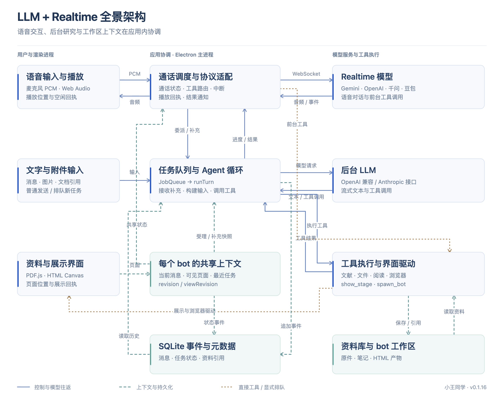
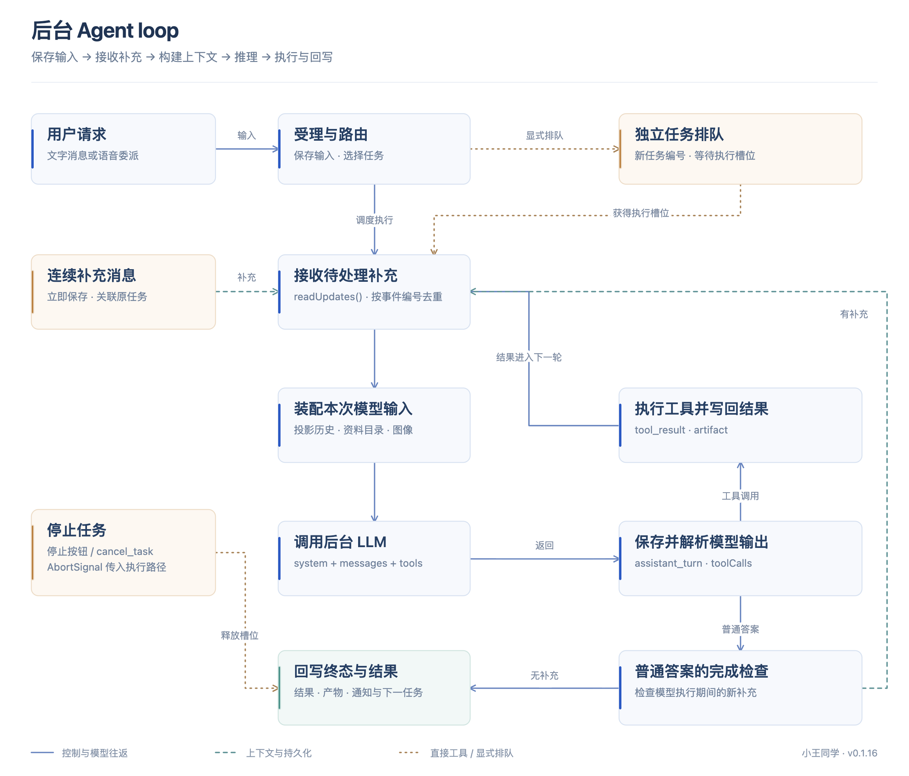
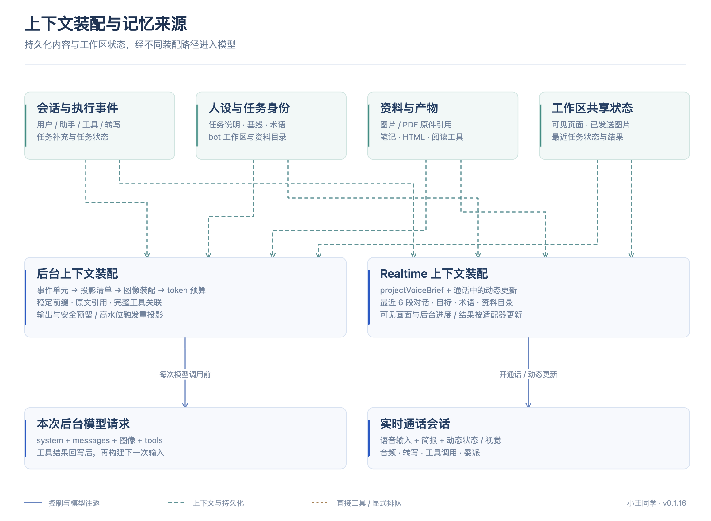
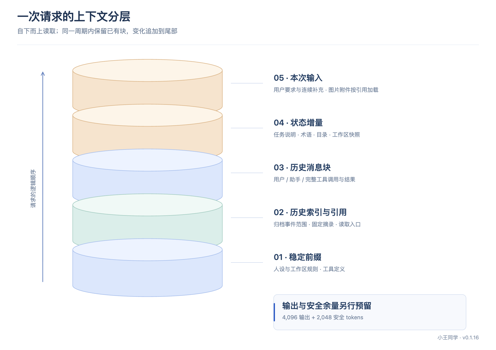
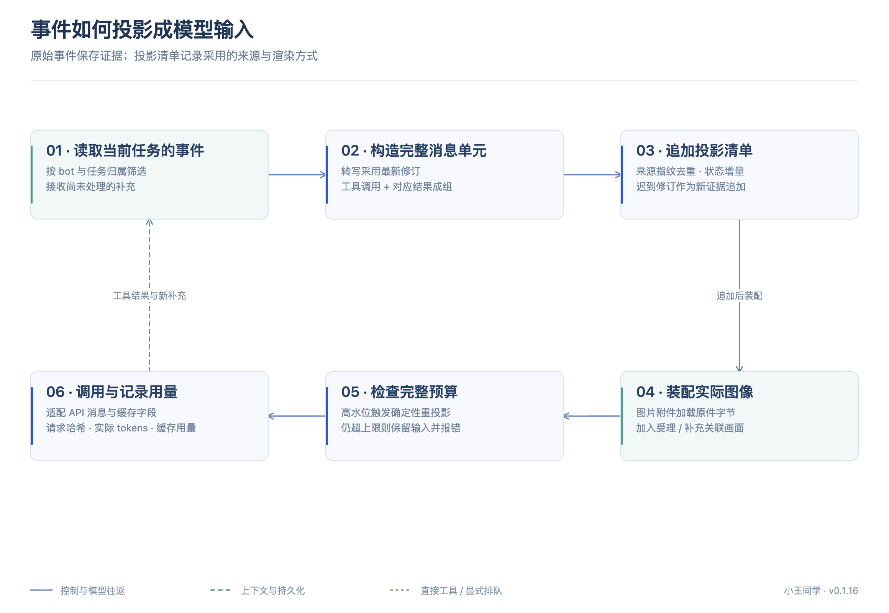
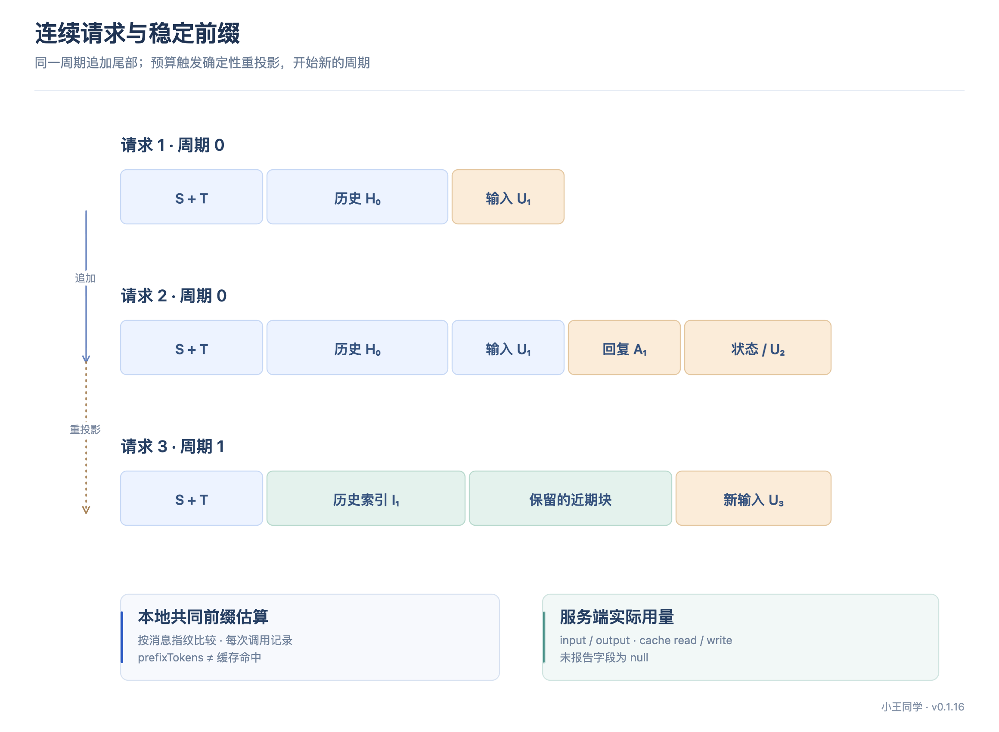
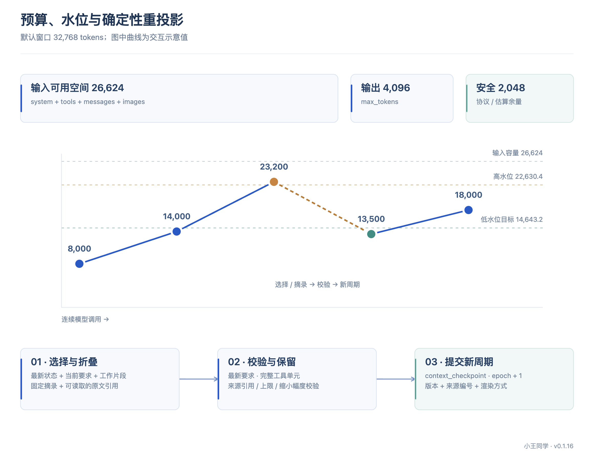

# 小王同学的 Agent 架构

[交互图](index.html) · 本文对应 v0.1.16 的实现。

## 交互与研究有不同的时间要求

语音回应需要尽快开始，研究可能涉及多轮检索、阅读和工具调用。用户还会补充要求、打断讲解或切换资料。小王将实时对话和研究执行分别交给 Realtime 与后台 LLM，通过应用层协调。

模型理解请求、生成内容和选择工具。应用保存事件、执行工具，根据任务状态和用户实际听到的播放位置安排下一步。

## 两类模型如何协作

Realtime 处理语音，可以直接读取或展示资料。多步研究通过 `delegate_task` 进入本地 `JobQueue`，通话继续接收输入。后台执行进度和结果回到通话上下文，口头汇报依据用户发言、播放状态与通知设置安排。

bot 标识确定会话、资料与工作区，`originCallId` 关联发起任务的通话。已经受理的研究在挂断后可以继续，结果保存在原通话记录。

[桌面协调](../desktop/main/index.ts) · [语音委派](../src/voice-tasks.ts)

## 一次任务如何执行

请求先保存，再新建任务或补充当前任务。同一个 bot 串行执行，默认最多两个工作区并发。显式“排队新任务”创建独立任务。

每一步接收尚未处理的补充，准备上下文并调用 LLM。模型返回工具调用时，应用执行工具、记录结果，再进入下一步。返回普通答案后再次检查补充，无待处理消息才确认完成。

新工具调用获得应用生成的编号，结果通过 `assistantEventId` 关联执行事件。旧日志中的重复工具编号按最近对应的调用配对。停止操作通过 `AbortSignal` 传入模型和支持取消的工具。桌面任务最多执行 40 步，已有结果与补充保留，供检查和重试。

[执行循环](../src/harness.ts) · [任务队列](../src/jobs.ts)

## 两类模型各自接收什么

后台 LLM 从事件生成任务视图，接收固定规则、工具定义、选中的历史、任务快照、当前要求与图片。Realtime 开通话时接收简报，通话中持续接收页面、任务和结果更新。

任务在受理时复制工作区快照，补充消息带入对应的新快照。用户单纯翻页时，通话的可见页面随之更新。独立 `viewRevision` 用于淘汰迟到画面。

Gemini、OpenAI 和千问接收已发送图片及右侧图片、PDF 当前页，视觉队列每秒最多发送一帧。豆包当前通过后台模型处理图片与 PDF 分析。

通话初始简报取最近 6 段对话，每段最多 180 字符；目标最多 500 字符，附带术语、资料目录与最近 8 个产物路径。资料目录最多列出 40 项。共享快照取最近 6 个任务，每项结果最多 3,000 字符。这些边界用于简报与共享状态，后台历史由 token 预算和任务归属决定。

Gemini Live 另启用服务端 `slidingWindow` 会话压缩，其内部 token 与缓存不进入后台模型统计。

[共享状态](../src/shared-context.ts) · [附件](../src/attachments.ts) · [视觉队列](../src/visual-queue.ts)

## 一次后台请求由哪些层组成

稳定的 `system` 与 `tools` 描述身份、工作区规则和工具能力。`messages` 来自明确的事件与快照，按投影清单规定的顺序和方式渲染。

| 内容 | 来源与策略 |
| --- | --- |
| 固定规则、工具、预算 | `context_scope` 保存作用域定义，相同配置复用同一作用域 |
| 历史索引与引用 | 历史归档后提供事件数量、范围与反查入口 |
| 选中的对话与工具单元 | 原始事件；调用与对应结果一起处理 |
| 任务与工作区状态 | `context_state` 保存受理或补充时的快照；重投影保留每个状态键的最新值 |
| 当前要求与连续补充 | 按当前任务的输入事件编号保护，保持原文 |
| 图片 | 附件按引用加载；临时页面帧只在当前进程内保留 |

## 事件如何成为确定性投影

`projectContextUnits` 将事件转为完整单元，处理语音修订和工具结果归属。`context_append` 保存来源编号、修订引用与渲染方式，避免另存一份持续改写的消息历史。

`renderEntry` 只使用清单指定的事件，恢复相应视图。已经发送的转写被修订时，追加更新说明。同一事件、版本、预算与可用原件得到相同视图，投影过程不调用模型或重跑工具。

当前正常执行路径使用此管理器，旧的 `projectLlmContext` 字符裁剪函数仍保留供兼容调用使用。临时页面帧不写入事件，状态文字始终说明其可用范围；重启后图片附件可以恢复，临时画面需要重新获取。

[事件单元](../src/project.ts) · [纯投影函数](../src/event-projection.ts) · [投影与检查点](../src/context-manager.ts)

## 稳定前缀与缓存

同一周期内，已有消息保持顺序与内容，新消息追加在尾部。任务背景、目录变化和转写修订作为新证据进入。工具定义与固定指令保持稳定，适配器保留用户消息块边界。

只有超过预算水位，程序才一次性重建视图并递增 `epoch`。这时较早的内容可以变成固定摘录或历史引用，随后继续追加。

官方 OpenAI 请求带作用域与周期派生的 `prompt_cache_key`，Anthropic 使用自动 `cache_control`。`XIAOWANG_PROMPT_CACHE=off` 可关闭可选缓存字段。稳定前缀提供复用机会，实际命中由服务端决定。

`model_usage` 保存请求哈希、完整预算、耗时与实际用量。OpenAI 读取 `cached_tokens`，DeepSeek 读取缓存命中字段；Anthropic 总输入合计普通输入、缓存创建与读取。缺失的实际指标为 `null`。`prefixTokens` 仅为相邻成功请求的共同前缀估算，重启或周期切换后从 0 开始。

`npm run xiaowang -- stats [slug]` 查看调用、检查点及 token 用量。缓存读取比例只使用同时报告输入和缓存读取的调用。

## 完整预算与确定性重投影

默认采用 32,768 tokens 的应用窗口，预留 4,096 输出和 2,048 安全空间，输入容量为 26,624。预算包含 system、工具 schema、消息、工具参数及结果、实际装配的图片。

文本通过本地 `o200k_base` BPE 分段估算，增加 20% 余量与封装开销；图片每张预留 8,192 tokens。官方 Anthropic 使用原生计数覆盖总输入，分项仍为本地估算。模型真实窗口和实际用量由服务商决定。

超过输入容量的 85% 时，以 55% 为目标重建视图：

1. 保留当前任务原始输入、连续补充、每个键的最新状态和最后一个对话单元。
2. 被取代的旧状态退出当前视图。
3. 较旧工具结果采用前 1,200 字符的固定摘录，附原始事件编号；参数较大的旧工具单元可以整体变为事件引用。
4. 如仍需缩小，优先归档已结束任务，其余按较旧单元顺序处理，提供统一的历史反查入口。
5. 最终输入在硬预算内且确实缩小后，提交检查点并进入新周期。

低水位是目标，必要内容较大时可以高于目标。原生计数仍超限时再尝试归档全部可选历史。当前要求或最新状态本身无法容纳时返回预算错误，原事件与原投影保留。

`context_checkpoint` 保存投影版本、截止事件、来源编号、渲染方式、状态引用与保护集合。相同清单可从原事件重放，取消不会提交半成品。上下文维护不生成自动 LLM 摘要。

| 环境变量 | 默认值 |
| --- | --- |
| `XIAOWANG_CONTEXT_WINDOW` | 32768 |
| `XIAOWANG_MAX_OUTPUT_TOKENS` | 4096 |
| `XIAOWANG_CONTEXT_SAFETY_TOKENS` | 2048 |
| `XIAOWANG_IMAGE_TOKEN_BUDGET` | 8192 / 张 |

[预算](../src/token-budget.ts) · [选择与折叠](../src/event-projection.ts)

## 历史如何被再次使用

`search_memory` 在当前 bot 的原始记录中检索，支持字面关键词、事件类型与 `after_id` 分页，每页最多 20 条。SQLite FTS5 trigram 索引支持中文子串，少于 3 个字符时使用字面查询。

`inspect_event` 按事件编号读取原文，使用字符偏移分页，默认 4,000 字符、最多 6,000，并返回下一偏移量。读取历史不重新执行原工具。查询与读取都校验当前 bot 的访问范围，派生投影与用量事件不提供模型反查。

原始事件保留用户要求、模型输出、工具结果和转写修订；原件与产物仍通过文件和阅读工具使用。归档只减少本次输入包含的信息，模型需要时通过反查展开证据。用户请求的研究笔记和分析结论继续作为普通产物保存。

任务背景和工作区快照保存受理时的值。bot 元数据与资料引用仍有状态表，全部界面操作尚不能由事件日志重放。备份需要数据库、资料库与工作区；临时页面像素、音频队列和 Gemini 恢复句柄仅在进程内维护。

[历史原文](../src/memory.ts) · [存储与全文索引](../src/store.ts) · [历史工具](../src/tools.ts)

## 通话、工作区与恢复

渲染进程报告真实播放位置、片段完成与空闲状态。用户插话停止匹配的本地音频并过滤旧回复。自然挂断依据明确的用户请求，等待道别实际播放完成。Gemini 的讲解推进在生成和播放结束后等待页面展示回执，再请求下一段。

`spawn_bot` 交接任务说明、术语、资料引用与首轮要求，父轮成功后启动子任务。每个 bot 拥有独立会话、资料引用、工作区、浏览页面和控制权，浏览器共用持久化 Session 共享网站登录。

队列恢复排队任务，应用关闭时正在执行的任务恢复为 `interrupted`，用户检查产物后可重试。工具错误作为结果交回模型，模型请求异常由队列记录失败。

[通话调度](../desktop/main/call.ts) · [Gemini 通话](../desktop/main/gemini-call.ts) · [浏览器](../desktop/main/browser.ts) · [任务恢复](../src/jobs.ts)

## 技术栈与验证

桌面使用 Electron、React 与 TypeScript，阅读器使用 PDF.js，展示产物采用 HTML。后台通信支持 OpenAI 兼容和 Anthropic 接口及 SSE，Realtime 使用服务商原生 WebSocket 适配。执行与存储使用 Node.js 24、SQLite WAL / FTS5 和文件系统。

[上下文测试](../test/context-manager.test.ts)覆盖前缀、预算、确定性检查点、取消、重启、连续补充和状态保留；[历史测试](../test/memory.test.ts)覆盖中文搜索、分页、权限、原文读取与工具归属；[接口测试](../test/context-provider.test.ts)覆盖实际缓存用量解析。
